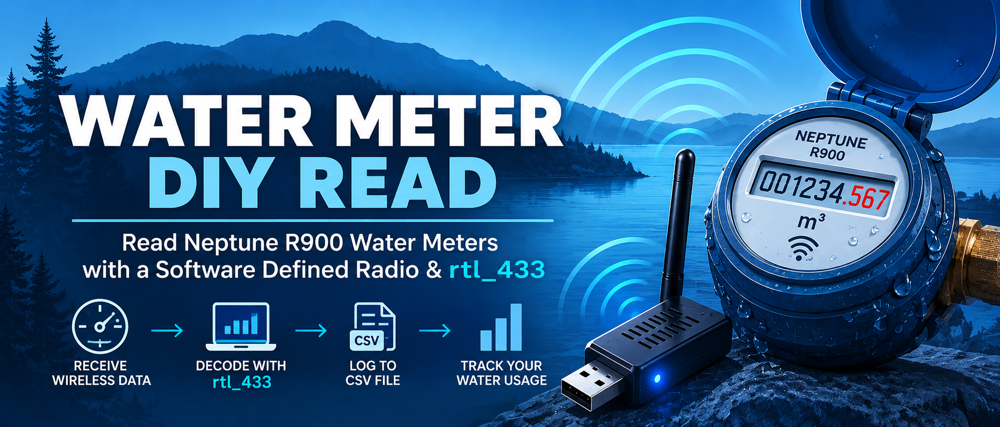
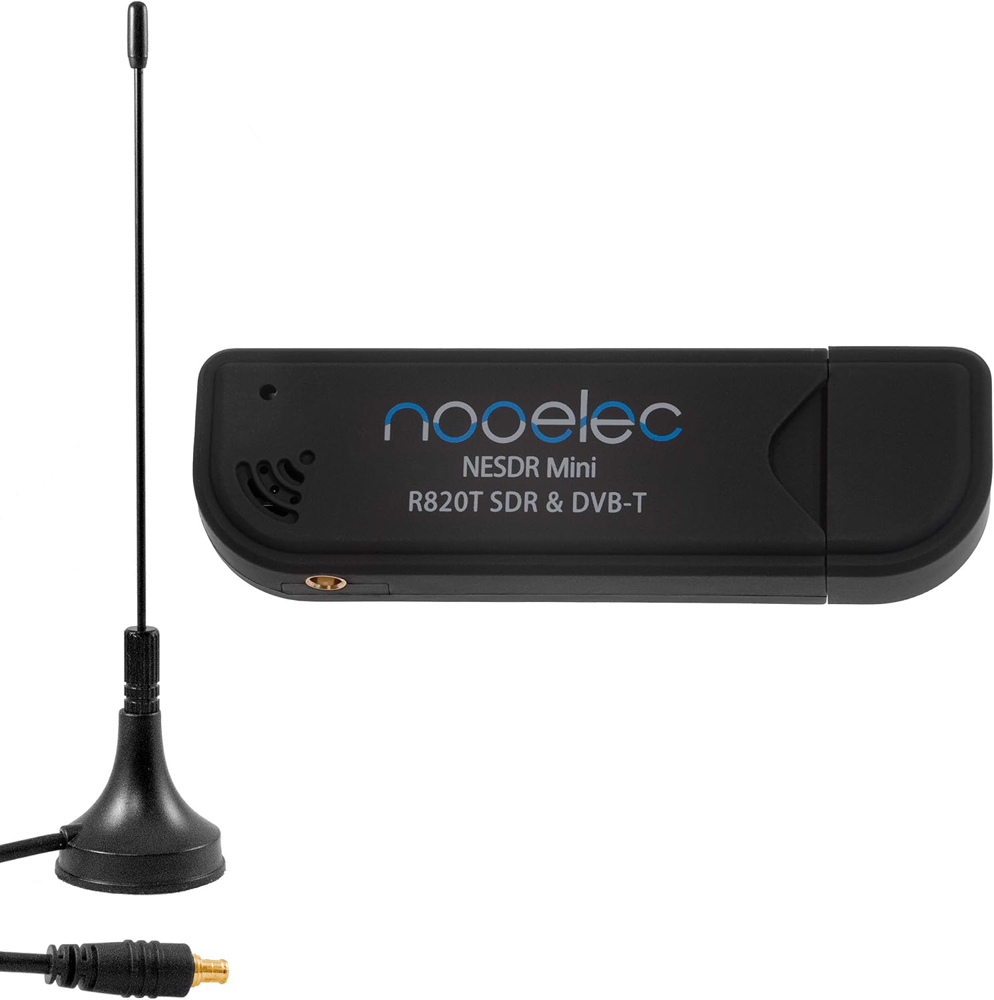
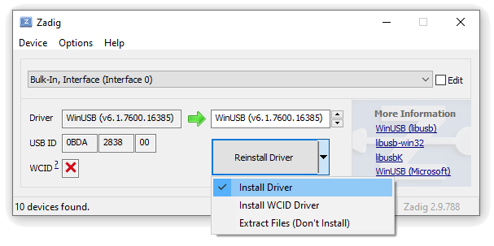
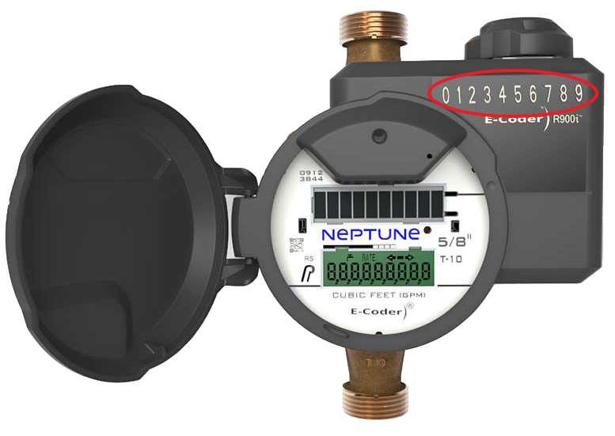
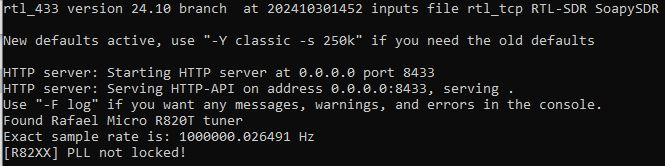
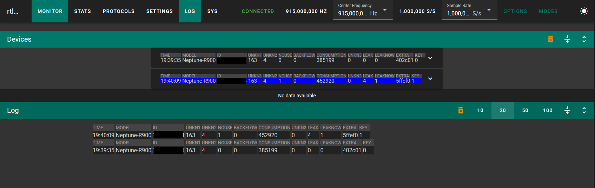
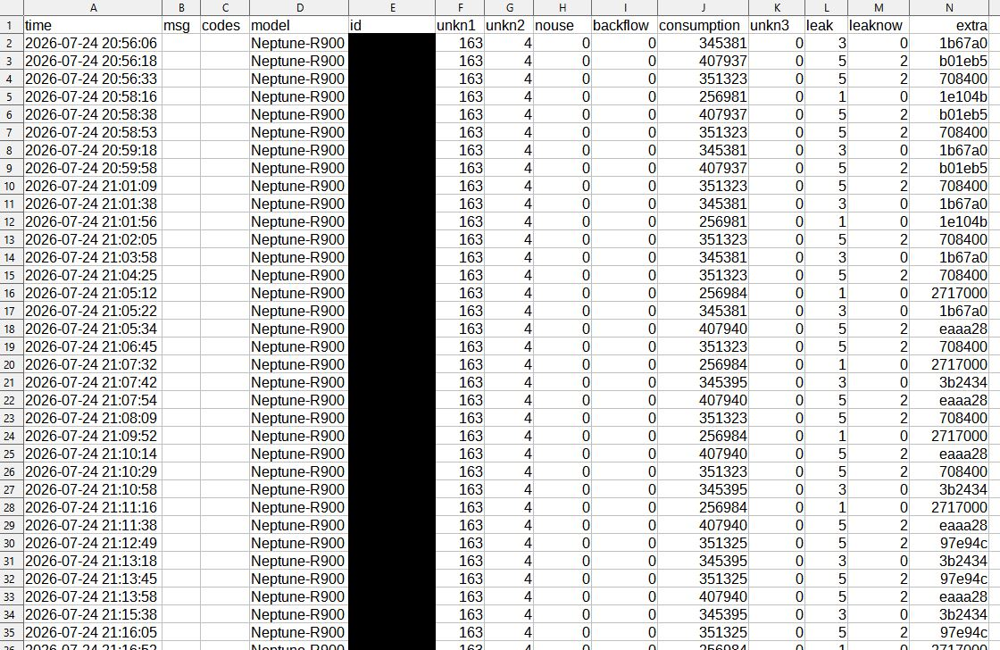

# Water Meter DIY Read

Read Sunshine Coast Regional District Neptune R900 water meters using a low-cost Software Defined Radio (SDR) receiver and the open-source rtl_433 software package.

This project provides step-by-step instructions for residents who wish to monitor their own water consumption using publicly transmitted radio telemetry.



## Overview

This guide documents a working method for receiving Neptune R900 water meter broadcasts using:

* NooElec NESDR Mini SDR
* rtl_433
* Windows 64-bit

In testing, the stock antenna was able to receive approximately five nearby water meters from inside a home, suggesting a practical reception radius of roughly 50 metres.

## Hardware Required

### SDR Receiver

NooElec NESDR Mini SDR

[https://www.amazon.ca/NooElec-NESDR-Mini-Compatible-Packages/dp/B009U7WZCA/](https://link.amazon/B0dQ6kY26) (Affiliate Link)



## Software Required

### rtl_433

This guide uses the rtl_433 fork maintained at:

https://github.com/merbanan/rtl_433

**Latest stable release:** https://github.com/merbanan/rtl_433/releases/latest

**Known-working Windows 64-bit version (24.10):** https://github.com/merbanan/rtl_433/releases/download/24.10/rtl_433-win-x64-24.10.zip

Version 24.10 is the version used for the original successful Windows setup. Newer versions may differ and should be tested before being described as verified.

## SDR Driver Installation

Follow the official [NooElec NESDR installation guide](https://support.nooelec.com/hc/en-us/articles/360005298053-NESDR-Installation-Guide) if device names differ. Only replace the driver for the intended SDR device, not an unrelated USB device.


1. Plug in the SDR.
2. Download and run [Zadig](https://zadig.akeo.ie/).
3. Select **Options → List All Devices**.
4. Select the RTL2832U device.
5. Confirm the device shows as RTL2838UHIDIR or Bulk-In Interface 0.
6. Install the WinUSB driver.
7. Wait for installation to complete.
8. Disconnect and reconnect the SDR.




## Identifying Your Meter

Open the meter box lid and locate the Neptune meter ID.

Record the number exactly as shown.




## Reading All Meters Within Range

Only collect or retain readings from meters you are authorized to monitor.


Open Command Prompt:

```cmd
cd C:\rtl_433-win
rtl_433 -f 915000000 -R 228 -F http -F csv:readings.csv
```


This command:

* Tunes to 915 MHz
* Enables Neptune protocol 228
* Saves readings to CSV
* Launches a local web interface

## Viewing Live Data

While rtl_433 is running visit:

http://localhost:8433/

It can take several minutes for data to start to appear depending on distance from meter and other parameters. You can match your meter ID to the ID column reported both in the browser as well as any exported CSV files you create.



## Saving Data to Excel

The command above creates:

```text
readings.csv
```

Open the file directly in Excel.



## Reading Only Your Meter

**Important:** The example below filters console text, not the CSV output. Do not rely on it to keep other meter IDs out of `my_meter.csv`. A correctly filtered CSV script still needs verification against real decoder output.


Use the included batch file:

```bat
@echo off

set METER_ID=12345678

rtl_433 -f 915000000 -R 228 -F json | findstr /C:"%METER_ID%"
```

Replace the meter ID with your own. This example displays matching JSON lines in the console; it does not create a CSV. See `examples/read_my_meter.bat`.

## Understanding Neptune R900 Broadcasts

Neptune R900 endpoints periodically transmit meter readings over the 915 MHz ISM band.

rtl_433 includes support for Neptune devices through Protocol 228.

The software decodes broadcasts and reports:

* Meter ID
* Consumption reading
* Signal information
* Timestamp

## Range Observations

Observed performance with the stock antenna:

* Approximately 5 meters received indoors
* Roughly 50 metre radius
* No antenna upgrades tested yet

Performance will vary based on:

* Terrain
* Building materials
* Antenna placement
* Radio interference

## Troubleshooting

### No Data Received

Verify:

* SDR drivers installed correctly
* SDR connected
* Protocol 228 enabled
* Frequency set to 915 MHz

### Web Interface Not Loading

Ensure rtl_433 is currently running.

### CSV Not Appearing

Verify rtl_433 is being launched from the intended folder.

## Disclaimer

This project is not affiliated with the Sunshine Coast Regional District, Neptune Technology Group, rtl_433, or NooElec.

The author provides these instructions for educational purposes only.

Users are responsible for complying with all applicable laws and regulations. Only access and monitor water meter data that you are authorized to access.
